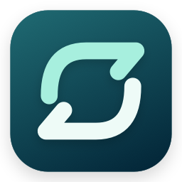
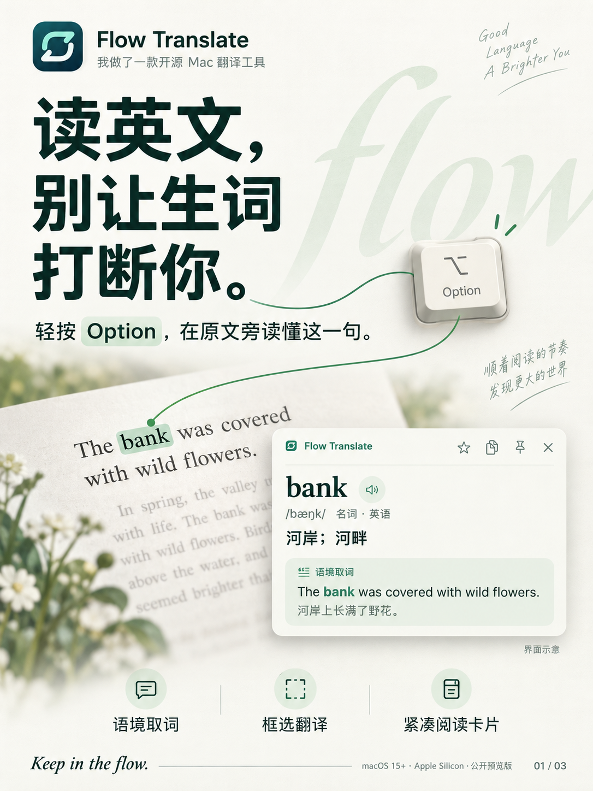
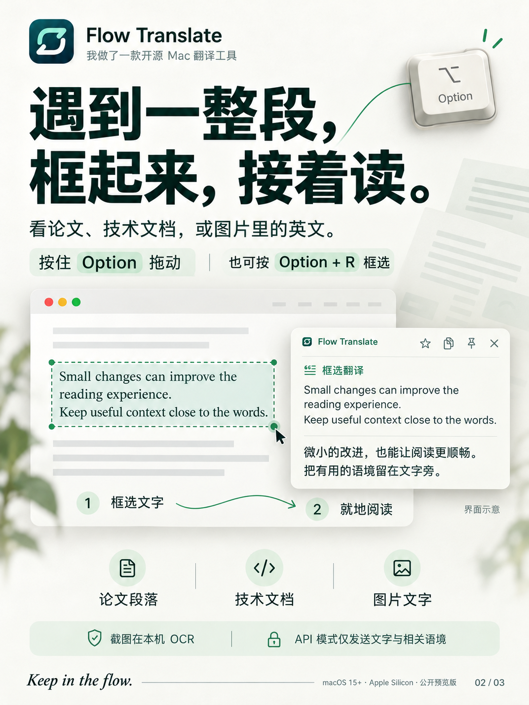
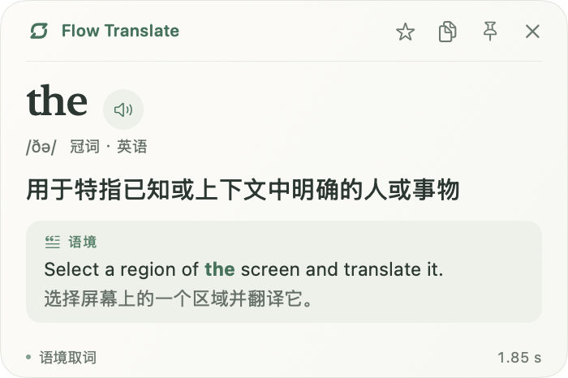
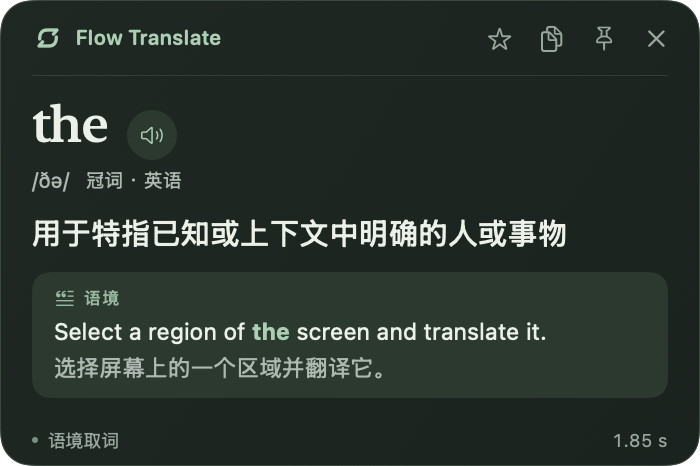

<p align="center"></p>
<h1 align="center">Flow Translate</h1>
<p align="center">理解，然后继续阅读。<br>Keep in the flow.</p>
<p align="center"><a href="README.en.md">English</a> · <a href="https://github.com/xyizhan/flow-translate/releases/tag/v0.4.0-beta.1">下载安装</a> · <a href="docs/CONFIGURATION.md">全部配置</a> · <a href="LICENSE">MIT License</a></p>

Flow Translate 是原生 macOS 屏幕翻译工具。轻按 Option 取词，拖动框选一段文字，用紧凑的阅读卡片理解词义，再回到原文。支持自己的 DeepSeek / OpenAI 兼容 API，也可选择 Apple 系统翻译。

## 阅读不断线

<p align="center">
  <a href="docs/assets/posters/01-contextual-lookup.png"></a>
  <a href="docs/assets/posters/02-region-translation.png"></a>
  <a href="docs/assets/posters/03-vocabulary-open-source.png"></a>
</p>
<p align="center"><sub>点击海报查看大图。海报中的窗口为功能示意，实际界面见下方阅读卡片。</sub></p>

| 阅读场景 | 怎么用 | 帮你解决什么 |
| --- | --- | --- |
| 读英文文章，遇到一词多义 | 鼠标停在词上，轻按左 Option | 结合所在句理解词义，例如 bank 在河岸场景中的含义 |
| 看论文、技术文档或图片里的英文 | Option + 拖动，或 Option + R 框选 | 在原文旁读懂整段，减少复制和切换页面 |
| 想记住刚查过的词 | 点击卡片星标，之后在生词本复习 | 保存词义、原句与译文，也能导出 Anki |

**截图在本机 OCR，自选翻译服务。** API 模式只发送识别出的文字和相关语境，不上传截图；支持 DeepSeek / OpenAI 兼容 API，Key 保存在系统钥匙串。

<p align="center"><a href="https://github.com/xyizhan/flow-translate/releases/tag/v0.4.0-beta.1"><strong>下载 macOS 公开预览版</strong></a> · <a href="#三分钟开始使用">三分钟开始使用</a> · <a href="docs/CONFIGURATION.md">查看配置说明</a></p>

**当前发布：0.4.0-beta.1，首个公开预览版。** 下载包适用于 **Apple Silicon（M1 或更新芯片）+ macOS 15 或更新版本**。尚无 Developer ID 签名及 Apple 公证，首次打开需要按下方步骤确认。Intel、Windows、Linux 没有已验证的安装包。应用免费；API 用量由服务商另行计费，**不附带 API Key**。

## 下载安装

1. 在 [Releases](https://github.com/xyizhan/flow-translate/releases/tag/v0.4.0-beta.1) 下载 **`Flow-Translate-0.4.0-beta.1-macos-arm64.dmg`**。不要把 GitHub 的 `Source code` 压缩包当作安装包。
2. 打开 DMG，把 **Flow Translate.app** 拖到 **Applications（应用程序）**。推出磁盘映像，从“应用程序”启动，以后也从这一位置打开。
3. 如 macOS 提示“无法验证开发者”：先尝试打开一次，再到 **系统设置 → 隐私与安全性 → 仍要打开**，按系统提示确认。仅在确认下载自本仓库且文件完整时操作，详见 [Apple 官方说明](https://support.apple.com/102445)。不需要关闭 Gatekeeper、关闭 SIP 或运行管理员脚本。
4. 首次启动按引导配置自己的翻译服务和需要的权限。应用默认常驻菜单栏；关闭主窗口不等于退出，点击菜单栏图标仍可打开它。

也可下载同版本 `.zip`，解压后把应用移动到“应用程序”。每个发布附有 `SHA256SUMS.txt`，核对示例：

```sh
cd ~/Downloads
shasum -a 256 Flow-Translate-0.4.0-beta.1-macos-arm64.dmg
```

将结果与同一发布页的 `SHA256SUMS.txt` 比较。校验失败请重新下载；不要通过修改系统安全设置运行损坏的文件。[更多安装、更新和卸载说明](docs/INSTALL.md)。

## 三分钟开始使用

### 1. 配置翻译服务

首次引导，或 **设置 → 翻译服务**：

| 项目 | 默认配置 |
| --- | --- |
| 服务 | DeepSeek / OpenAI API |
| API 地址 | `https://api.deepseek.com` |
| 模型 | `deepseek-flash` |
| API Key | 在 [DeepSeek 控制台](https://platform.deepseek.com/api_keys) 获取自己的 Key |
| 快速模式 | 开启，关闭 DeepSeek 思考以减少等待 |
| 目标语言 / 第二目标语言 | 简体中文 / English |

点击“保存到钥匙串”，然后“测试翻译”。首次引导点击“下一步”会保存已填写的 Key。服务商可能调整模型可用性；如返回模型错误，请按你账号控制台可用的模型名填写。ChatGPT / DeepSeek 网页会员与 API 额度并不等同。

使用其他服务时，填写其 **Chat Completions** 兼容地址、模型和 Key；应用会自动补 `/chat/completions`。远程地址要求 HTTPS，本机 `localhost` / `127.0.0.1` 可使用 HTTP。词典模式要求模型支持流式输出及 `response_format: json_object`，并非所有“OpenAI 兼容”接口都支持这些功能。只填写可信服务的地址。

不想配置 API 时，可选择 **Apple 系统翻译**：不需要 API Key，首次使用可能要下载语言包；适合句段翻译，不提供 API 模式的完整音标、词性和语境词典字段。

### 2. 开启需要的权限

在 **设置 → 通用** 点击“开启”，或手动前往 **系统设置 → 隐私与安全性**：

| 权限 | 用途 | 是否必需 |
| --- | --- | --- |
| 屏幕录制 / 录屏与系统录音 | 在本机截图并 OCR，供框选和鼠标取词使用；应用不采集系统音频 | 屏幕翻译需要 |
| 辅助功能 | 监听 Option 手势、自动悬停、读取选中文字 | 这些交互需要 |

系统要求重开时，从菜单退出应用再打开。**输入 / 粘贴翻译无需以上两项权限**，可以先按 Option+I 试用。请给“应用程序”中的这份应用授权，而不是 DMG 中的临时副本。

### 3. 开始阅读

| 操作 | 功能 |
| --- | --- |
| 轻按左 Option | 取鼠标下的词，结合所在句解释 |
| Option + 点击 | 点击取词 |
| Option + 拖动 | 直接框选翻译 |
| Option + R | 显示框选层，再拖动选择 |
| Option + S | 翻译选中的文字，读取不到时回退鼠标取词 |
| Option + Space | 鼠标取词，可优先使用选中文字 |
| Option + I | 输入 / 粘贴翻译 |
| Return / Shift+Return | 提交 / 换行 |
| Esc | 取消框选或关闭当前译文卡片 |

卡片支持复制、发音、收藏和固定；固定的卡片会保留。英语发音可选美式 / 英式，重复点击发音切换慢速。菜单栏可暂停取词，快捷键冲突时可在设置中重新绑定。

## 紧凑的阅读卡片

暖白与深色两种主题，按内容调整大小，让译文留在原文旁边。以下为应用实际界面：

<p align="center"> </p>

## 还能做什么

- **本地 OCR**：通过 Apple Vision 识别，API 模式只发送文字和相关语境，不上传截图。
- **语境取词**：定位鼠标下的词和所在句，支持跨行句子，避免把整个窗口都当作上下文。
- **阅读卡片**：暖白 / 深色主题，按内容收缩，长文滚动，流式显示译文。
- **生词本与复习**：收藏原句和译文，搜索筛选，按四级自评分安排下次复习；导出 CSV、Anki APKG、纯文本。
- **最近查询**：本机保留最近 40 次词典查询；不会自动加入生词本。
- **可选交互**：自动悬停、普通点击取词、应用排除、目标语言切换、开机启动。自动悬停和普通点击默认关闭。

[查看所有设置、默认值、兼容接口与故障排查](docs/CONFIGURATION.md)。

## 隐私与安全

- 没有内置共享 Key、账号登录、广告、统计 SDK 或自动更新上传。
- API Key 仅保存到当前 Mac 的系统钥匙串；应用包和 Git 仓库不包含用户配置或凭据。
- API 模式会把当前选择的文字和相关句子发送到你配置的服务商，受其数据政策约束；不要翻译不愿发送给该服务的敏感内容。
- 生词本和查询历史位于 `~/Library/Application Support/FlowTranslate/`，是本机权限限制的 JSON，**不是加密数据库**。
- API 请求不跟随 HTTP 重定向。截图不落盘，失败 / 截断结果不缓存。

详见 [隐私说明](PRIVACY.md) 和 [安全问题报告](SECURITY.md)。请勿在 Issue、日志或截图中附 API Key、个人文档或系统密码。

## 从源码构建

需要 macOS 15+、Swift 6.0+ 及支持该系统的 Xcode / Command Line Tools。无需第三方 Swift 包。安装命令行工具后：

```sh
xcode-select --install
git clone https://github.com/xyizhan/flow-translate.git
cd flow-translate
zsh scripts/verify.sh
zsh scripts/build-app.sh
```

应用生成在 `dist/Flow Translate.app`。将它放到“应用程序”再授权；构建时会拒绝覆盖仍在运行的同路径应用。发布构建会移除调试符号并映射本机源码路径。

```sh
# 生成 DMG、ZIP 和 SHA-256 校验文件
zsh scripts/package-release.sh 0.4.0-beta.1
```

[贡献指南](CONTRIBUTING.md) 说明测试、结构和提交方式；[维护者发布流程](docs/RELEASING.md) 说明签名、公证及发布检查。

## 发布范围与已知限制

这是可使用的公开预览版，不是“所有软件和语言都已验证”的稳定版。核心状态机、流式 API / 错误 / 缓存 / 取消、本地 OCR、语境截取、生词本及导出有自动检查；首次配置和卡片经过原生界面检查。详见 [验证范围](docs/VALIDATION.md)。

- 尚未获得 Developer ID 签名及 Apple 公证，更新临时签名构建可能需要重新授权；当前没有自动更新器。
- 发布包仅为 arm64；macOS 15 是最低目标版本，不代表所有 15.x 版本均已做实机测试。
- 中文竖排、复杂多列、极小字体、受保护视频、部分游戏或远程桌面的 OCR 可能不可靠。
- 部分应用不提供辅助功能选区；遇到问题请改用框选。替代修饰键和普通点击功能未覆盖所有实体键鼠环境。
- Apple 系统语言包流程、Intel 运行和实际注销后自动启动未覆盖完整实机矩阵。
- 英文界面已提供，部分运行阶段与错误消息仍为中文。

本项目独立实现，灵感来自屏幕取词类工具的公开交互，与 Hover Translate、Apple、DeepSeek 或 OpenAI 没有隶属关系；不包含原产品二进制、反编译材料或私有后端。原创应用代码及几何图标按 [MIT License](LICENSE) 发布。
